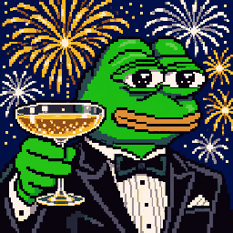

**English** | [한국어](README.ko.md)

# dots-pepe

An agent skill (a folder with a `SKILL.md`) that makes new images from a single pixel-art Pepe by changing only the **outfit, hand, background and expression**.

Generating images from a text prompt alone gives you a different Pepe every time. This skill passes the base image (`assets/pepe_base.png`) to the image generator as a **reference image (edit mode)** and splits the prompt clearly into "keep" and "change", so the face shape and framing stay the same.

## Example



Made with a request like `/dots-pepe Gatsby Pepe in a tuxedo holding a champagne glass, fireworks in the background`.

| Slot | Value |
|---|---|
| Outfit | Black tuxedo, white shirt, black bow tie |
| Hand | Champagne glass |
| Background | Fireworks in a dark night sky |
| Expression | Default (smug smile) |

## How it works

1. When you say something like "draw a pirate Pepe", the agent extracts four slots from the request: outfit, hand, background and expression.
2. It fills the prompt template in `SKILL.md` in English. Slots you did not mention keep their defaults.
3. `scripts/generate.sh` edits the base image through the Codex CLI and writes a PNG.
4. The agent compares the result with the base image and generates once more if the face changed or the character was enlarged or moved.

## What stays fixed / what changes

| Fixed | Changes |
|---|---|
| Pixel-art style (about 128x128 grid, 1-pixel dark outlines) | Outfit |
| Head shape, size, tilt and position | Hand (held item or gesture) |
| Square framing, upper body, cropped at the bottom | Background |
| Eye size, lip color and outline | Expression |

The base image shows Pepe from the chest up in a blue t-shirt on a flat pale lavender background, with no hands visible.

## Defaults

Slots you do not mention use these values.

| Slot | Default |
|---|---|
| Outfit | Plain bright blue crew-neck t-shirt |
| Hand | None (both arms hang down, out of frame) |
| Background | Flat pale lavender-gray (`#D4DAF2`) |
| Expression | Smug smile (as in the base image) |

If you give only a concept such as "pirate Pepe", the outfit and background are filled in to fit it. A hand is added only when there is an item that clearly belongs to the concept, and you are told when one is added.

## Hands

- **None**: if hands are not mentioned, none are drawn.
- **Held item**: a knife, ladle, microphone, glass and so on. The hand is always drawn in the lower left of the frame, and the item is shrunk to fit inside the left edge.
- **Gesture**: thumbs-up, peace sign, waving, pointing. A salute needs the hand at the forehead, which conflicts with the fixed hand position, so another gesture is suggested.

## Expressions (7)

| Key | Description |
|---|---|
| `smirk` | Only the mouth corners lift by 1-2 pixels. Eyes and brows stay as in the default |
| `grin` | Mouth wide open in a big smile, eyes open and bright |
| `disappointed` | Mouth corners droop, heavy eyelids, pupils look down and sideways |
| `tears` | Mouth closed with trembling corners, two thin light-blue tear streams |
| `sob` | Eyes squeezed shut, mouth wide open in a wail, tears pouring |
| `angry` | Brows slanted sharply toward the center, hard glare, anger veins on the forehead |
| `scream` | Mouth wide open in a roar, bulging eyes, spit droplets and motion lines |

If you do not mention an expression, the default one is used. The intensity is exactly as strong as you ask for. Adding glances, raised brows or a wider mouth on its own makes Pepe far too smug.

## Hats, helmets and masks

- The default size of hats and helmets is fixed at **about 60% of the image width and about 15% of the image height**. Ask if you want a smaller or bigger one.
- Hats are described as resting on the head so they do not float above it, and the face, eyes and lips keep the same size and position.
- Helmets have the visor raised so the face stays visible. Sunglasses are pushed up onto the forehead.
- Wording like "smaller/bigger" barely moves the hat size, so the width and height are given as percentages of the image, such as "25% bigger". It is still not exact, and a bigger hat tends to make the head grow with it.
- A **mask** covers the whole face. Green skin shows between the straps and at the mask edges so Pepe is still recognizable. With a mask, the expression slot is ignored.

## Install

```bash
git clone https://github.com/DaeHo238/dots-pepe <your-agent-skills-dir>/dots-pepe
```

Requirements:

- An AI coding agent that supports `SKILL.md` skills and can run shell commands
- [Codex CLI](https://github.com/openai/codex), installed and logged in: `npm i -g @openai/codex`
- `sips` on macOS (falls back to Python Pillow if it is missing)

## Usage

In your agent, call the skill by name and describe what you want. Korean works too.

```text
/dots-pepe draw a pirate Pepe
/dots-pepe astronaut Pepe holding a star-shaped lollipop, space background
/dots-pepe tired developer Pepe, expression: tears
/dots-pepe 해적 페페 그려줘
```

Results are saved to the current folder.

| File | Contents |
|---|---|
| `<name>_prompt.txt` | The full English prompt that was used |
| `<name>.png` | Image at original size |
| `<name>_512.png` | Image scaled down to 512x512 |
| `<name>_codex.log` | Codex run log |

If you only want the prompt, say "prompt only". No image is generated, and you can attach the base image yourself in the Codex app.

## Expression set (several expressions at once)

Generates 7 expressions in parallel from one base prompt. The outfit, hand and background stay the same; only the expression text changes.

```bash
python3 scripts/generate_set.py <name>_prompt.txt <name>                  # all 7
python3 scripts/generate_set.py <name>_prompt.txt <name> smirk sob angry  # only some
```

Expression keys: `smirk` `grin` `disappointed` `tears` `sob` `angry` `scream`. The expression texts live in `scripts/expressions.json`. Running 7 at once uses a lot of Codex quota.

## Automatic framing check

After an image is generated, `scripts/check_framing.py` runs automatically. It uses the position and width of the lips (orange-brown) to see whether the head moved or grew, and prints PASS, WARN or SKIP.

```bash
python3 scripts/check_framing.py <image.png>          # default
python3 scripts/check_framing.py <image.png> --expr   # image with a changed expression (wider allowed mouth width)
```

- WARN if the horizontal or vertical mouth position is off the base by more than 4 percentage points, or the mouth width is outside 0.88-1.12x of the base (0.65-1.30x with `--expr`).
- SKIP if no lips are found (a full-face mask, a prop covering the mouth). Check by eye.
- It is not affected by hats or by body color. It catches images that were deliberately shifted or enlarged, but it has not flagged a real generated image yet, so treat it as a secondary check.
- Needs Pillow (`pip install pillow`). Without it, only the post-generation check is silently skipped.

## Things to know

- **Privacy**: when an image is generated, the base image and the prompt are sent to OpenAI.
- **Existing characters**: the iconic masks, costumes and logos of film, game and comic characters are not drawn as is; a new design that keeps only the mood is drawn instead. Requesting the original as is can also be blocked by the image safety filter.
- **Text and logos**: image models often draw text and brand marks wrongly. The skill defaults to "no text" and tells the model that branded props have a plain surface. Short phrases can come out readable if you say "exactly this text, large, evenly spaced, in simple blocky pixel letters", but longer text breaks more easily and its position is not matched precisely.
- **Flags**: unless the outfit really needs one, "no national flags or country insignia" is added to stop stray patches.
- **Real military uniforms**: text searches alone cannot confirm the details. Only the clothing details visible in a reference photo (hat shape, positions of pockets, name tags and rank, sleeve length) are copied, and the person in the photo is not drawn.
- **Framing drift**: the most common failure is the character being enlarged (especially with a hat or helmet) or the head shifting. It also happens easily with wide-open-mouth expressions (grin, sob, scream), so the framing is compared with the base after generation, and `check_framing.py` checks it automatically.

## Folder structure

```text
dots-pepe/
├── SKILL.md              The skill itself: workflow, prompt template, expression and hand texts, notes
├── README.md             This document (English)
├── README.ko.md          Korean version
├── assets/
│   └── pepe_base.png     Base image (512x512 pixel art)
├── examples/
│   └── gatsby.png        README example image
└── scripts/
    ├── generate.sh       Generate with the Codex CLI, scale to 512, check framing
    ├── generate_set.py   Generate 7 expressions in parallel
    ├── expressions.json  Prompt text for each expression
    └── check_framing.py  Framing check from lip position and width
```

## Customizing

- To change the default outfit, background or expression, edit the "Defaults" section of `SKILL.md`.
- To use a different base image, replace `assets/pepe_base.png` and update the framing numbers in the `SKILL.md` template (head top 17%, right edge 87%, chin 60%, and so on) to match. `check_framing.py` relies on the lip color of the base image (around `#C8783A`), so if your lips are a different color, adjust the color range in the script too.
- To add an expression, put the same text in both `SKILL.md` and `scripts/expressions.json`.
